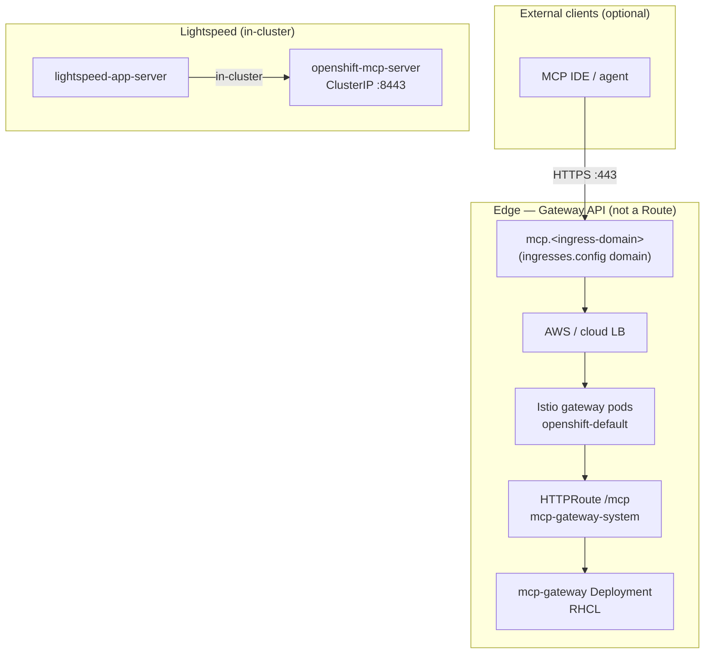
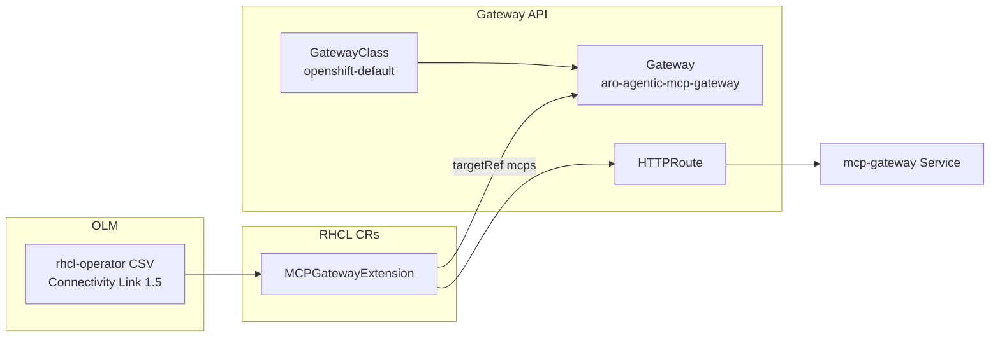
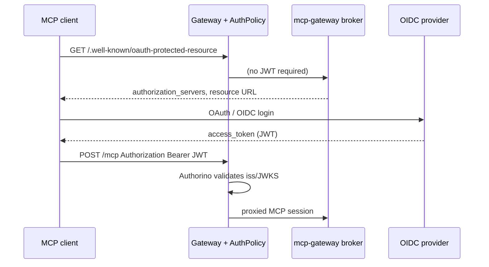

# MCP and gateway networking (OpenShift 5)

## Product default: no public MCP endpoint

**Validated-pattern bootstrap does not create a public MCP URL by default.** You get **Lightspeed** plus the in-cluster **`openshift-mcp-server`** (ClusterIP only). **RHCL** (`rhcl-operator`, Kuadrant) still installs for future use; **`Gateway` + `MCPGatewayExtension`** are **opt-in**.

Public edge exposure requires explicit operator action and a completed auth design — not ad-hoc TLS on an open `/status`.

| What ships today | What is deferred |
|------------------|------------------|
| COO, Lightspeed, RHCL operator subscriptions | Production **external** MCP on `mcp.<ingress-domain>` |
| In-cluster MCP for Lightspeed | IdP selection, MCP OAuth 2.1 (RFC 9728), `AuthPolicy` rollout |
| GitOps manifests under `gitops/gateway-openshift/` (reference) | `MCPServerRegistration`, fleet-wide MCP exposure |

**Opt in (labs only, after reading [Roadmap](#roadmap-production-grade-external-mcp)):**

```bash
export ENABLE_MCP_GATEWAY_PUBLIC=true
# Optional legacy alias: export SKIP_MCP_GATEWAY=false
make cluster.<profile>.bootstrap
```

**Tear down an existing public gateway** (after a lab experiment):

```bash
oc delete authpolicy mcp-gateway-oidc -n openshift-ingress --ignore-not-found
oc delete mcpgatewayextensions mcp-gateway -n mcp-gateway-system --ignore-not-found
oc delete gateway aro-agentic-mcp-gateway -n openshift-ingress --ignore-not-found
oc delete -f gitops/gateway-openshift/referencegrant.yaml --ignore-not-found
# GatewayClass openshift-default may remain (shared); remove only if no other Gateway API users.
```

---

## Roadmap: production-grade external MCP

Before setting `ENABLE_MCP_GATEWAY_PUBLIC=true` in any shared or production cluster, decide and document:

1. **Authorization server** — Corporate OIDC (Entra, Keycloak, etc.). [MCP Authorization](https://modelcontextprotocol.io/specification/2025-11-25/basic/authorization) treats the AS as **out of scope**; OpenShift console OAuth is **not** a drop-in MCP issuer.
2. **MCP roles** — Resource server = RHCL broker/gateway; client = IDE/agent; Bearer JWT + `/.well-known/oauth-protected-resource` (RFC 9728).
3. **Edge pattern** — RHCL documented path: **Gateway API** listener + **`MCPGatewayExtension.oauthProtectedResource`** + **Connectivity Link `AuthPolicy`** (Authorino JWT). Alternatives (oauth2-proxy, ext_authz) are **not** documented in this pattern until we add an ADR.
4. **TLS** — Terminate with **IngressController `defaultCertificate`** Secret (e.g. Let’s Encrypt on ROSA), not `default-ingress-cert`.
5. **Operational gates** — Anonymous `/status` and `/mcp` return **401**; verify with `make cluster.<profile>.verify`; register backends via `MCPServerRegistration` when ready.
6. **Tracking** — Open a GitHub issue (epic) in `validated-pattern-aro-agentic` for “production MCP edge” with IdP, acceptance criteria, and E2E verify steps before merging enablement into default bootstrap.

The sections below describe **how the opt-in gateway works** (reference architecture), not what runs after a default bootstrap.

---

This document explains how the stack **can** expose MCP on a cluster, why that path does **not** use a classic `Route`, and how that differs from what **OpenShift Lightspeed** uses internally. It is aimed at cluster admins used to `route.openshift.io/Route` on port 443 only.

**Official references**

| Topic | Documentation |
|--------|----------------|
| Gateway API on OpenShift | [Configuring Gateway API (OCP 5.0)](https://docs.redhat.com/en/documentation/openshift_container_platform/5.0/html/ingress_and_load_balancing/configuring-gateway-api) |
| MCP gateway install (RHCL) | [Install and configure MCP gateway (Connectivity Link 1.5)](https://docs.redhat.com/en/documentation/red_hat_connectivity_link/1.5/html/install_the_mcp_gateway/mcp-gateway-install) |
| Ingress Operator / `openshift-default` | [Ingress and load balancing](https://docs.redhat.com/en/documentation/openshift_container_platform/5.0/html/ingress_and_load_balancing/) |

## Two MCP paths on the same cluster

Most admins think of **one** “MCP” when Lightspeed is installed. In this recipe there are **two separate paths**:

| Path | Purpose | Exposure | TLS |
|------|---------|----------|-----|
| **Lightspeed `openshift-mcp-server`** | Tools for the Lightspeed app (Prometheus, `oc`-style APIs, etc.) | **ClusterIP** only — no `Route`, no public URL | HTTPS on pod/service (serving cert) |
| **RHCL MCP gateway** (Connectivity Link 1.5) | Optional **external** MCP aggregation (`MCPGatewayExtension`) | **Gateway API** + cloud load balancer on **`mcp.<ingress-domain>`** | **HTTPS :443**, same Secret as **IngressController default Certificate** |

Lightspeed works without the public gateway. The gateway is for **external MCP clients** and **registered** backends (`MCPServerRegistration`). This repo does not register `openshift-mcp-server` on the gateway by default.



## Why there is no `Route` for MCP

Console, Argo CD, and Prometheus still use **`route.openshift.io/Route`** (HAProxy ingress, familiar `*.apps.<domain>` on **443**).

**Red Hat Connectivity Link** documents external MCP on **Kubernetes Gateway API** (`gateway.networking.k8s.io`), not on a `Route`. When `ENABLE_MCP_GATEWAY_PUBLIC=true`, the bootstrap script:

1. Enables **`GatewayClass` `openshift-default`** (Ingress Operator provisions a **lightweight Istio** control plane in `openshift-ingress` — not a full service mesh).
2. Creates **`Gateway` `aro-agentic-mcp-gateway`** with listener **`mcps`**.
3. Applies **`MCPGatewayExtension`**; the RHCL controller creates **`HTTPRoute`** objects and the **`mcp-gateway`** service.

Admins will see **`istiod-openshift-gateway`** and gateway workload pods after bootstrap. That is **expected** for Gateway API; it is **not** “we installed OpenShift Service Mesh for the whole cluster.”

```mermaid
sequenceDiagram
  participant Admin as Cluster admin
  participant Boot as gitops-bootstrap.sh
  participant OCP as Ingress / Gateway controller
  participant RHCL as RHCL operator
  participant GW as MCP gateway

  Admin->>Boot: make cluster.&lt;profile&gt;.bootstrap
  Boot->>OCP: GatewayClass openshift-default
  OCP-->>OCP: istiod-openshift-gateway (slice only)
  Boot->>OCP: Gateway aro-agentic-mcp-gateway (HTTPS mcps)
  Boot->>RHCL: MCPGatewayExtension mcp-gateway
  RHCL->>GW: HTTPRoute, mcp-gateway Deployment
  Note over GW: /status, /mcp, OAuth metadata paths
```

## TLS and the wildcard cert

The MCP listener must reuse the **same TLS Secret the default router uses for `Route`s**, not `default-ingress-cert`:

| Secret | Issuer (typical on ROSA) | Used by |
|--------|--------------------------|---------|
| **`*-primary-cert-bundle-secret`** (name from IngressController) | Let's Encrypt | **Routes** (console, Argo, …) |
| **`default-ingress-cert`** | OpenShift `root-ca` (cluster-local) | Gateway API **default** in generic OCP docs — **wrong trust chain for ROSA** |

Bootstrap resolves the router secret via **`IngressController/default`** → **`spec.defaultCertificate.name`** in `openshift-ingress` (`router_tls_secret_name` in `gitops-bootstrap.sh`). Template placeholder: `REPLACE_ROUTER_TLS_SECRET`.

Hostname on the listener: **`mcp.<ingress-domain>`**, where `<ingress-domain>` is `ingresses.config/cluster` → `spec.domain`. Bootstrap sets `mcp_host="mcp.${domain}"` — **do not** prepend another `apps.` when building URLs.

```yaml
# gitops/gateway-openshift/gateway.yaml (listener excerpt; secret name filled at bootstrap)
protocol: HTTPS
port: 443
tls:
  mode: Terminate
  certificateRefs:
    - kind: Secret
      name: REPLACE_ROUTER_TLS_SECRET
```

**Terminate** means TLS ends at the gateway; traffic from the gateway to the **`mcp-gateway`** Service is **plain HTTP** inside the cluster (normal for this pattern per RHCL docs).

Verify the router secret and issuer:

```bash
tls_secret_name="$(oc get ingresscontroller default -n openshift-ingress-operator -o jsonpath='{.spec.defaultCertificate.name}')"
oc get secret "${tls_secret_name}" -n openshift-ingress -o jsonpath='{.data.tls\.crt}' \
  | base64 -d | openssl x509 -noout -issuer -ext subjectAltName
```

**Public URL (after bootstrap):**

```text
https://mcp.<ingress-domain>/mcp
https://mcp.<ingress-domain>/status
```

Example (ROSA): `https://mcp.apps.rosa.<cluster>.<id>.p3.openshiftapps.com/status`

Clients must use the **ingress apps domain** in the hostname (`https://mcp.${ingress_domain}/…` where `ingress_domain` is `ingresses.config/cluster` → `spec.domain`). **Do not** build `mcp.apps.${ingress_domain}` — that double-prefixes `apps` and causes **hostname / SAN mismatch** errors.

### TLS smoke test

```bash
domain="$(oc get ingresses.config cluster -o jsonpath='{.spec.domain}')"
curl -fsS "https://mcp.${domain}/status"
echo | openssl s_client -connect "mcp.${domain}:443" -servername "mcp.${domain}" 2>/dev/null \
  | openssl x509 -noout -issuer -ext subjectAltName
```

If `curl` fails with **hostname mismatch**, you likely used `mcp.apps.${domain}` while `domain` already starts with `apps.`.

Port **8080** and **HTTP** are no longer used for the external listener in this recipe (older lab configs may still mention them).

## Component map

| Object | Namespace | Role |
|--------|-----------|------|
| `GatewayClass openshift-default` | cluster-scoped | Turns on Gateway API controller (Istio slice) |
| `Gateway aro-agentic-mcp-gateway` | `openshift-ingress` | Hostname, TLS, listener `mcps` |
| `ReferenceGrant` | `openshift-ingress` | Allows RHCL CRs in `mcp-gateway-system` to attach routes |
| `MCPGatewayExtension mcp-gateway` | `mcp-gateway-system` | RHCL entry point; `sectionName: mcps` must match Gateway listener name |
| `HTTPRoute mcp-gateway-route` | `mcp-gateway-system` | Created by RHCL; paths `/mcp`, `/.well-known/oauth-protected-resource`, `/status` |
| `Subscription rhcl-operator` | `kuadrant-system` | **Red Hat Connectivity Link** 1.5 (OLM) |
| `OLSConfig` / `openshift-mcp-server` | `openshift-lightspeed` | Lightspeed in-cluster MCP (separate from gateway) |



## Bootstrap knobs

| Variable / file | Effect |
|-----------------|--------|
| **`ENABLE_MCP_GATEWAY_PUBLIC=true`** | **Opt in** to public Gateway API MCP (default **unset** / false) |
| `SKIP_MCP_GATEWAY=false` | Legacy alias for enable (deprecated; prefer `ENABLE_MCP_GATEWAY_PUBLIC`) |
| `gitops/gateway-openshift/gateway.yaml` | Gateway listener TLS template (`REPLACE_CLUSTER_DOMAIN` → `mcp.<apps domain>`) |
| `scripts/gitops-bootstrap.sh` → `apply_openshift_gateway` | Applies GatewayClass, Gateway, ReferenceGrant (only when opted in) |
| `gitops/operators/rhcl/mcp-gateway-extension.yaml` | `privateHost` patched to in-cluster gateway Service DNS (internal control plane hop; still port 8080 on the gateway Service) |

Installer prerequisite: **`openshift-gitops`** namespace must exist (`make cluster.<rosa-profile>.bootstrap` from [vp-terraform-rosa](https://github.com/rh-mobb/validated-pattern-terraform-rosa) or equivalent) **before** agentic bootstrap.

## OIDC authentication

Transport TLS does **not** replace OAuth. When the public gateway is enabled, **`apply_mcp_gateway_oidc`** configures:

1. **`MCPGatewayExtension.spec.oauthProtectedResource`** — discovery at `/.well-known/oauth-protected-resource` (excluded from JWT enforcement).
2. **`AuthPolicy` `mcp-gateway-oidc`** — JWT validation via **Authorino** on Gateway listener `mcps` (`/mcp`, `/status`, … return **401** without a valid Bearer token).

Official procedure: [RHCL — MCP gateway authentication](https://docs.redhat.com/en/documentation/red_hat_connectivity_link/1.5/html/secure_your_traffic/mcp-gateway-authentication).



### What is **not** a valid OIDC issuer here

| Mechanism | Works for MCP gateway JWT auth? |
|-----------|----------------------------------|
| **`oc whoami --show-token`** (opaque session token) | **No** — not a JWT for Authorino |
| **`oauth.<cluster>` / console login** (ROSA OAuth server) | **No** — no OIDC discovery/JWKS for arbitrary MCP clients ([oauth metadata](https://oauth.openshift.com/) differs from Keycloak-style issuers) |
| **Kubernetes service account issuer** (`serviceAccountIssuer`) | **M2M only** — possible advanced recipe; not console users |
| **Keycloak / Entra / corporate OIDC** | **Yes** — RHCL reference pattern |

### Configure in `agentic.json` (or Terraform → `make cluster.<profile>.apply`)

```json
{
  "mcp_oauth_issuer_url": "https://keycloak.example.com/realms/mcp",
  "mcp_oauth_authorization_servers": [
    "https://keycloak.example.com/realms/mcp"
  ]
}
```

Terraform (optional): `mcp_oauth_issuer_url` and `mcp_oauth_authorization_servers` in `clusters/<profile>/terraform.tfvars` merge into `agentic.json` on apply.

Bootstrap defaults **`MCP_GATEWAY_OIDC_REQUIRED=true`**. Without issuer URLs, bootstrap **fails** (set `MCP_GATEWAY_OIDC_REQUIRED=false` only for temporary lab exposure).

**Verify after bootstrap:**

```bash
domain="$(oc get ingresses.config cluster -o jsonpath='{.spec.domain}')"
curl -fsS "https://mcp.${domain}/.well-known/oauth-protected-resource" | jq .
curl -sS -o /dev/null -w '%{http_code}\n' "https://mcp.${domain}/status"   # expect 401
```

With a valid JWT from your IdP:

```bash
curl -fsS "https://mcp.${domain}/status" -H "Authorization: Bearer ${ACCESS_TOKEN}"
```

## Security expectations (when public gateway is enabled)

1. Do **not** enable the public listener without **OIDC** (`mcp_oauth_issuer_url` in `agentic.json`); bootstrap defaults **`MCP_GATEWAY_OIDC_REQUIRED=true`** when the gateway runs.
2. **`/.well-known/oauth-protected-resource`** stays unauthenticated so clients can discover the IdP.
3. **`MCPServerRegistration`** — without registrations, `/status` is authenticated but still reports `servers: []`.
4. **`MCP_GATEWAY_OIDC_REQUIRED=false`** is for temporary lab debugging only — never on shared clusters.

## Reconcile after changing the Gateway

If you edit `gateway.yaml` on an existing cluster:

```bash
domain="$(oc get ingresses.config cluster -o jsonpath='{.spec.domain}')"
tls_secret_name="$(oc get ingresscontroller default -n openshift-ingress-operator -o jsonpath='{.spec.defaultCertificate.name}')"
sed \
  -e "s|mcp.REPLACE_CLUSTER_DOMAIN|mcp.${domain}|g" \
  -e "s|REPLACE_ROUTER_TLS_SECRET|${tls_secret_name}|g" \
  gitops/gateway-openshift/gateway.yaml | oc apply -f -
# If MCPGatewayExtension was Ready before, it usually reconciles; restart kuadrant operator only if status stalls (see gitops-bootstrap.sh).
curl -fsS "https://mcp.${domain}/status" | jq .
# ${domain} must be ingresses.config/cluster spec.domain (starts with apps.), not the short cluster DNS name alone.
```

## Related docs in this repo

- [Agentic stack deploy](agentic-stack.md)
- [Platform contract](platform-contract.md)
- Installer (ROSA): [vp-terraform-rosa platform contract](https://github.com/rh-mobb/validated-pattern-terraform-rosa/blob/main/docs/guides/platform-contract.md)