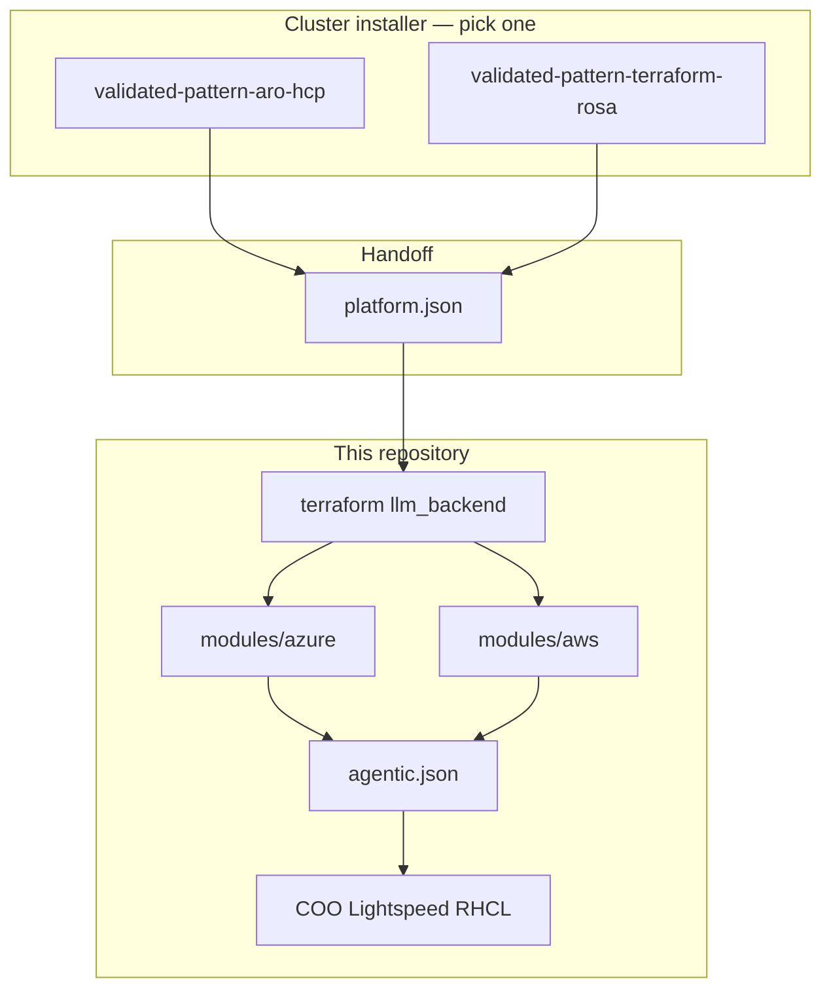

# OpenShift agentic layer

Day-2 stack for **OpenShift Lightspeed**, **Cluster Observability (Perses)**, and **Red Hat Connectivity Link** on an existing **OpenShift 5** cluster.

This repository does not create the cluster. Create it with one installer, publish that installer's platform contract, then run this checkout against it.

| Installer | Cluster | LLM in this repo |
|-----------|---------|------------------|
| [validated-pattern-aro-hcp](https://github.com/rh-mobb/validated-pattern-aro-hcp) | Azure Red Hat OpenShift, hosted control plane | Azure OpenAI over a private endpoint (`llm_backend=azure`) |
| [validated-pattern-terraform-rosa](https://github.com/rh-mobb/validated-pattern-terraform-rosa) | Red Hat OpenShift Service on AWS, hosted control plane | Amazon Bedrock (`llm_backend=aws`) |

Both installers must publish `platform.json` (`contract_version: 1`) before `make cluster.<name>.apply` here. Field lists: [Platform contract](guides/platform-contract.md).

**MCP:** Bootstrap does not publish a public MCP URL. Lightspeed uses the in-cluster `openshift-mcp-server`. A public Gateway API endpoint is opt-in: [MCP gateway networking](guides/mcp-gateway-networking.md).

## Documentation map

| I want to… | Start here |
|------------|------------|
| Pick ARO or ROSA and see the handoff | [Choose an installer](prerequisites/index.md) |
| Check quota, identity, and tools | [Account prerequisites](prerequisites/account.md) |
| Copy an example profile and deploy | [Quick start](getting-started/quick-start.md) |
| See apply, bootstrap, verify, and destroy | [Agentic stack](guides/agentic-stack.md) |
| Match `platform.json` to `agentic.json` | [Platform contract](guides/platform-contract.md) |
| Expose MCP outside the cluster | [MCP gateway networking](guides/mcp-gateway-networking.md) |
| Lightspeed fails for an Entra console user | [Invalid user ID](troubleshooting/lightspeed-entra-invalid-user-id.md) |

## How the pieces fit



## Example profiles

| Profile | Cloud | `llm_backend` |
|---------|-------|----------------|
| `clusters/public` | Azure / ARO HCP | `azure` (default) |
| `clusters/aro-agentic` | Azure / ARO HCP | `azure` (default) |
| `clusters/rosa-public` | AWS / ROSA HCP | `aws` |

Copy a profile to `clusters/<name>/` and point `platform_json` at the installer file. State, logs, and `agentic.json` stay on the machine.

## Local preview

```bash
pip install -r requirements-docs.txt
make docs-preview
```

Open [http://127.0.0.1:8000/layer-ocp-agentic/](http://127.0.0.1:8000/layer-ocp-agentic/).

## Related

- [GitHub repository](https://github.com/rhcs-validated-patterns/layer-ocp-agentic)
- [ARO HCP docs](https://rh-mobb.github.io/validated-pattern-aro-hcp/)
- [ROSA HCP docs](https://rh-mobb.github.io/validated-pattern-terraform-rosa/)
